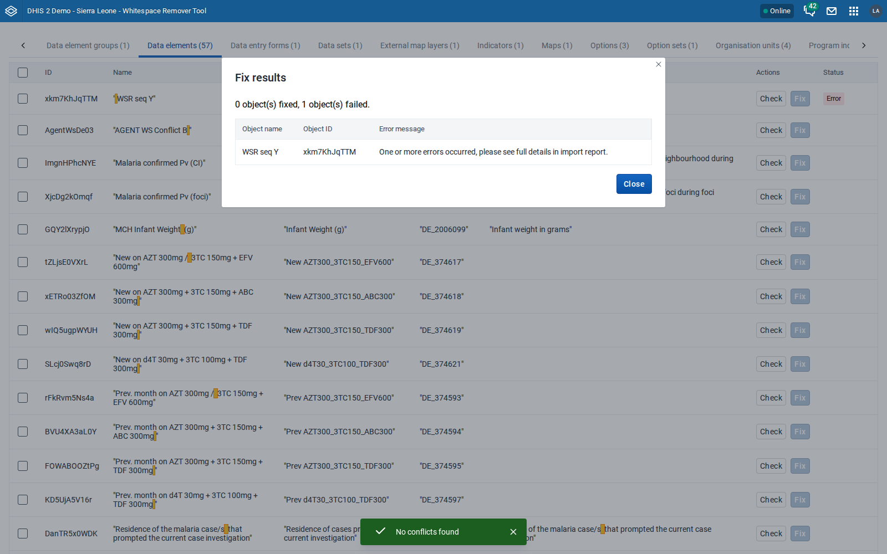

# UI test results: Whitespace Remover Tool v1.0.0

Tested: 2026-10-22 · App: the production bundle `tool-whitespace-remover-1.0.0.zip`,
built from `main` (cd4ac7e) in a clean clone, installed with `POST /api/apps`
(204 on 2.41, 201 on 2.42 and 2.43) · Test data: the Sierra Leone demo
database for each version, plus objects that the suites seed. Every test ran
on a throwaway instance with a superuser that holds the `ALL` authority.

Build baseline in the clean clone, using the CI install command: lint, typecheck,
unit tests (40/40) and build all pass.

## Instances

| Label | DHIS2 version | Database                |
| ----- | ------------- | ----------------------- |
| 2.41  | 2.41.10       | Sierra Leone demo (v41) |
| 2.42  | 2.42.7        | Sierra Leone demo (v42) |
| 2.43  | 2.43.2        | Sierra Leone demo (v43) |

The instances were deleted after testing.

## Results

### Acceptance suite in the repo (`test/e2e/run_suite.py`)

| Step                                                                                        | 2.41      | 2.42      | 2.43      |
| ------------------------------------------------------------------------------------------- | --------- | --------- | --------- |
| App loads (2.42 and later inside the global shell iframe), scan completes                   | PASS      | PASS      | PASS      |
| Data elements tab, seeded row, pagination, whitespace highlighting                          | PASS      | PASS      | PASS      |
| Single check to **Ready**, fix removes the row, API shows name, code and short name cleaned | PASS      | PASS      | PASS      |
| Conflict detection (modal, row tagged **Conflict**)                                         | PASS      | PASS      | PASS      |
| Organisation unit with a duplicate name is not a conflict, fix cleans it                    | PASS      | PASS      | PASS      |
| Bulk check selected, summary modal                                                          | PASS      | PASS      | PASS      |
| **Total**                                                                                   | **21/21** | **21/21** | **21/21** |

### Safety and edge-case suite (new for this review)

The suite seeds its own objects, drives the UI and checks every result
against the API. Afterwards it deletes everything it created.

| Test                                                                                                                               | 2.41      | 2.42      | 2.43      | Notes                                                                          |
| ---------------------------------------------------------------------------------------------------------------------------------- | --------- | --------- | --------- | ------------------------------------------------------------------------------ |
| HTML in a name (``) is shown as text and does not run                                                                 | PASS      | PASS      | PASS      |                                                                                |
| Data element: the four fields cleaned; no other owner field, translation, attribute value, legend set or aggregation level changed | PASS      | PASS      | PASS      |                                                                                |
| Organisation unit: cleaned; geometry, parent, attribute value and group membership unchanged                                       | PASS      | PASS      | PASS      |                                                                                |
| Indicator: cleaned; numerator, denominator and their descriptions unchanged                                                        | PASS      | PASS      | PASS      | `numeratorDescription` (not a cleaned field) keeps its whitespace, as designed |
| Group memberships kept (data element group, organisation unit group)                                                               | PASS      | PASS      | PASS      |                                                                                |
| Two objects with whitespace-only codes (`"  "`, `"   "`) can both be fixed                                                         | PASS      | PASS      | PASS      |                                                                                |
| Conflict found for a name with `:` `,` `[]` `()`                                                                                   | PASS      | **FAIL**  | **FAIL**  | M1: on 2.42 and later a comma breaks the `eq` filter                           |
| Bulk check flags two selected objects that clean to the same name                                                                  | PASS      | PASS      | PASS      |                                                                                |
| Two objects each checked **Ready** alone, then both fixed: the second fails safely with no duplicate created                       | PASS      | PASS      | PASS      | The error message is generic (M2)                                              |
| Issue only in the description is found and cleaned                                                                                 | PASS      | PASS      | PASS      |                                                                                |
| Issue only in the short name is not found                                                                                          | PASS      | PASS      | PASS      | Documented limitation                                                          |
| 23 objects fixed in one bulk run (two batches of 20 and 3)                                                                         | PASS      | PASS      | PASS      | "23 object(s) fixed, 0 object(s) failed"                                       |
| **Check** works on the first row of every listed type, no errors                                                                   | PASS      | PASS      | PASS      | 16 types listed                                                                |
| Cleanup leaves nothing behind                                                                                                      | PASS      | PASS      | PASS      |                                                                                |
| **Total**                                                                                                                          | **20/20** | **19/20** | **19/20** |                                                                                |

### Fixing one real object of every listed type, compared before and after

Each type's first **Ready** object was fixed through the UI. Its owner fields
were then compared before and after, ignoring element order and timestamps.

| Type                                                                            | 2.41                | 2.42          | 2.43          | Side effects                                                           |
| ------------------------------------------------------------------------------- | ------------------- | ------------- | ------------- | ---------------------------------------------------------------------- |
| Data element groups, data entry forms, options, program rules, validation rules | OK                  | OK            | OK            | None                                                                   |
| Data sets, option sets                                                          | OK                  | OK            | OK            | `version` + 1 (expected DHIS2 behavior)                                |
| Programs                                                                        | Fix refused (E6000) | OK            | OK            | `version` + 1                                                          |
| Program indicators, program stages                                              | OK                  | OK            | OK            | None (order only)                                                      |
| External map layers                                                             | OK                  | OK            | OK            | `sharing.public` null written as `rw------`; same effective access     |
| Maps without operands                                                           | OK                  | OK            | OK            | `rawPeriods` and `subscribers` null written as `[]`                    |
| Visualizations without operands                                                 | OK                  | n/t           | n/t           | None                                                                   |
| **Visualizations with data element operands**                                   | **Corrupted**\*     | **Corrupted** | **Corrupted** | H1: operands lose their data element; the object no longer loads (400) |
| **Maps with data element operands**                                             | n/t                 | n/t           | **Corrupted** | H1                                                                     |

n/t: not tested on that version. \* On 2.41 the same visualization could not be read after the fix, but the
before-snapshot was not recorded separately in that run. On 2.42 and 2.43 the
object was confirmed healthy before the fix and broken after it.

## Version-specific failures

- **2.42 and 2.43**: a comma in a value hides conflicts from the check (M1).
- **2.41**: program `M3xtLkYBlKI` cannot be patched (E6000, a server
  validation that does not depend on the tool). The fix fails safely.
- H1 affects all three versions.

## Console and network hygiene

- An expected `409 PATCH dataElements/<id>` for each version, from the duplicate
  name test.
- `404 staticContent/logo_banner` on every version: the header bar asks for a
  logo the database does not have. Harmless.
- Console: "This window is not a secure context, PWA features will not work".
  This comes from testing over plain HTTP and does not happen over HTTPS.
- No page errors, and no other 4xx or 5xx responses.

## Screenshots

