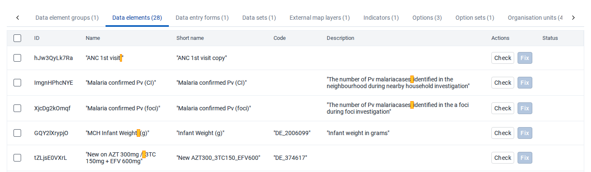
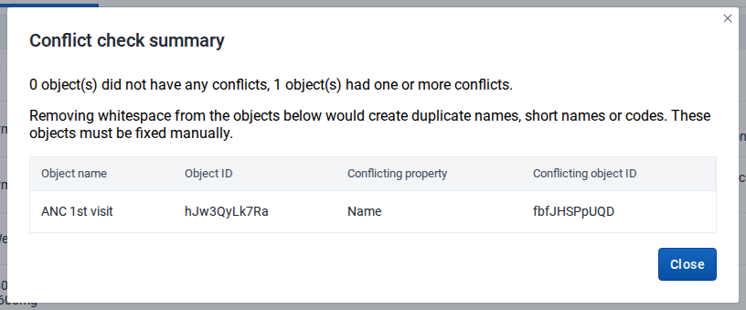

# Whitespace Remover Tool { #tool-whitespace-remover }

## About the tool { #tool-whitespace-remover-about }

The Whitespace Remover Tool finds metadata with extra whitespace in its name, short name, code or description, and removes it. The tool is for system administrators and implementers who maintain DHIS2 metadata.

Extra whitespace is hard to see. It makes two objects look the same in lists and reports, and it stops searches and imports from matching a value.

The tool treats these as extra whitespace:

- In names, short names and codes: whitespace at the start or end, two or more spaces in a row, and any line break, tab or non-breaking space. These often come in when a value is pasted from a spreadsheet or a document. The tool replaces each of them with a single space.
- In descriptions: whitespace at the start or end, spaces at the end of a line, and two or more spaces or tabs in a row between words. The tool keeps the line breaks, blank lines and indentation of a description, so paragraphs and lists stay as they are.

## Before you start { #tool-whitespace-remover-before-you-start }

The tool works with DHIS2 2.41 and later.

To use the tool, you need:

- The `F_METADATA_EXPORT` authority, or the `ALL` authority, to scan the metadata.
- The authority to update each type of metadata that you want to fix, and metadata write sharing on each object.

The tool only finds the metadata that you have access to. To scan all metadata, use an account with the `ALL` authority.

> **Warning**
>
> The tool changes metadata, and it can change many objects at the same time. You cannot undo a change in the tool. Try the tool on a copy of your database first, and make a backup of your production database before you use it there.

### Check where names and codes are used { #tool-whitespace-remover-names-and-codes }

Most of DHIS2 refers to metadata by its ID, which the tool never changes. Some features and other systems find metadata by its name or code instead. When the tool removes whitespace from a name or code, anything that looks for the old value no longer finds the object.

> **Warning**
>
> Before you fix an object, check whether its name or code is used to match data or metadata. If it is, a fix can stop data from being imported or exchanged, without an error that points to the tool.

Look in particular at:

- Data exchanges and integrations that match metadata by code or name instead of ID. This includes aggregate data exchanges inside the same DHIS2 instance, imports from other systems, and scripts or interoperability tools that send data to DHIS2.
- ADX data imports. ADX identifies data sets, data elements, categories, category options and organisation units by code.
- Imports that use the **Code** or **Name** ID scheme, for example in the **Import/Export** app.
- Program rules that compare values with an option name. This happens when a program rule variable is set to use option names instead of option codes.
- SQL views, reports, spreadsheets and apps outside DHIS2 that look up metadata by name or code.
- Mappings in other systems, for example the codes that a national reporting system or a donor system uses to receive data from DHIS2.

If you find such a use, fix the object only when you can change the other side at the same time. Otherwise leave the whitespace in place.

## Install the tool { #tool-whitespace-remover-install }

You install the tool from a zip file, which you can download from GitHub or from the **DHIS2 Admin Toolbox** app. The tool is not on the App Hub.

1. Download the `tool-whitespace-remover-<version>.zip` file in one of these places:
    - On GitHub, from the [Whitespace Remover Tool releases](https://github.com/dhis2-utils/tool-whitespace-remover/releases).
    - In the **DHIS2 Admin Toolbox** app, click **Download** in the row of **Whitespace Remover Tool**.
2. Open the **App Management** app.
3. In the sidebar, choose **Manual install**.
4. Click **Upload an app to install**, and choose the zip file.

The tool shows in the app menu as **Whitespace Remover Tool**. The **DHIS2 Admin Toolbox** app also shows which version of the tool is installed and whether a newer version is available.

> **Note**
>
> Versions before 1.0.0 were called Whitespace Cleaner Tool. DHIS2 treats the Whitespace Remover Tool as a different app. After you install it, uninstall the Whitespace Cleaner Tool in the **App Management** app, and add the Whitespace Remover Tool to the user roles that gave access to the old app.

## Find whitespace issues { #tool-whitespace-remover-find }

When you open the tool, it scans your metadata for whitespace issues in names, short names, codes and descriptions. On a large database the scan can take a few minutes.

1. Open the **Whitespace Remover Tool** app. A progress bar shows while the tool scans the metadata.
2. Choose the tab for a type of metadata. Each tab shows the number of objects of that type with whitespace issues.

The table shows each value in quotation marks, with the extra whitespace highlighted:

- Yellow: whitespace that the tool can remove.
- Red: whitespace in a value that the tool never changes, because other data refers to that exact value. The tool shows a notice above the table that says why. An object with only red highlights has no **Check** or **Fix** button, and its status is **Fix manually**.

Whitespace that you cannot see gets a symbol inside the highlight: ↵ for a line break, ␍ for a carriage return, ⇥ for a tab, and ⍽ for a non-breaking space.

The table shows 50 objects per page. To change this, choose a number in **Items per page** under the table.

If the tool finds no issues, it shows **No whitespace issues found**.

## Check for conflicts { #tool-whitespace-remover-check }

Before you fix an object, the tool must check it for conflicts. A _conflict_ means that the object, without its extra whitespace, would have the same value as another object. For example, a data element named "ANC 1st visit " with a space at the end conflicts with an existing data element named "ANC 1st visit".

The tool checks the values that DHIS2 requires to be unique:

- For most types: name, short name and code.
- For organisation units: code only. Two organisation units can have the same name.
- For options: name only, within the same option set.

To check one object, click **Check** in its row. The status changes to **Ready** or **Conflict**. If there is a conflict, the **Conflict check summary** opens.

To check several objects:

1. Choose the checkbox of each object. To choose every object on the page, choose the checkbox in the table header.
2. Optional: to choose the objects on all pages, click **Select all … across all pages** at the bottom of the table.
3. Click **Check selected**. The **Conflict check summary** opens.
4. Click **Close**.

The tool also checks the chosen objects against each other, so two chosen objects that would get the same value both get the status **Conflict**.

The tool cannot fix an object with a conflict. Rename one of the two objects in the **Maintenance** app, and then refresh the tool.

The status of each object is one of these:

- **Ready**: the object has no conflict and you can fix it.
- **Conflict**: the object would get the same value as another object.
- **Error**: the check or the fix failed. The **Fix results** show the reason that DHIS2 gave.

## Fix whitespace issues { #tool-whitespace-remover-fix }

The tool removes extra whitespace from the name, short name, code and description of an object. It does not change any other property. You can only fix an object with the status **Ready**.

The tool never changes these values, and shows their whitespace in red:

- The code of an option. Tracker and aggregate data store the option code, not the option name, and program rules and expressions compare values against the code. A changed code would no longer match the values that are already stored, so the data would lose its option. The tool does fix the option name.
- The name of a program rule variable. Program rules refer to a variable by its exact name, for example `#{weight}`. A changed name would make every program rule that uses the variable invalid.

To clean one of these values, change it by hand in the **Maintenance** app, together with the data or the program rules that use it.

> **Warning**
>
> The next steps change metadata on the server straight away. You cannot undo the change in the tool.

To fix one object, click **Fix** in its row. The tool shows **Object fixed successfully**, and the object is removed from the table.

To fix several objects:

1. Check the objects. Each object must have the status **Ready**.
2. Click **Fix selected**. **Fix results** opens, with the number of objects fixed and failed.
3. Click **Close**.

If DHIS2 rejects a fix, the **Fix results** list the object with the reason, and the object keeps its status **Error**. DHIS2 can reject a fix when another user changed an object after you checked it.

## Known limitations { #tool-whitespace-remover-limitations }

- The tool only cleans the name, short name, code and description. It does not clean translations, form names, attribute values or other text.
- The tool does not change option codes or program rule variable names. It shows their whitespace in red. The section on fixing whitespace issues explains why.
- The tool does not show category option combinations. DHIS2 generates their names from the names of the category options.
- The tool does not show visualizations, event visualizations, maps or map layers. In DHIS2 2.41 to 2.43, a change to a visualization or a map through the API can remove the data elements from its data items, and map layers cannot be changed through the API at all. Rename them in the **Data Visualizer**, **Line Listing** or **Maps** app instead.
- When you fix a data set, an option set or a program, DHIS2 increases its version. The Android Capture app then downloads it again at the next synchronization.
- DHIS2 can reject a change to some objects for a reason that is not about whitespace, for example a program with data that does not pass validation on 2.41. The **Fix results** show the reason.
- The tool compares values exactly, with the same capital letters. Two values that differ only in capital letters are not a conflict.
- The tool only finds and fixes the metadata that you have access to.
